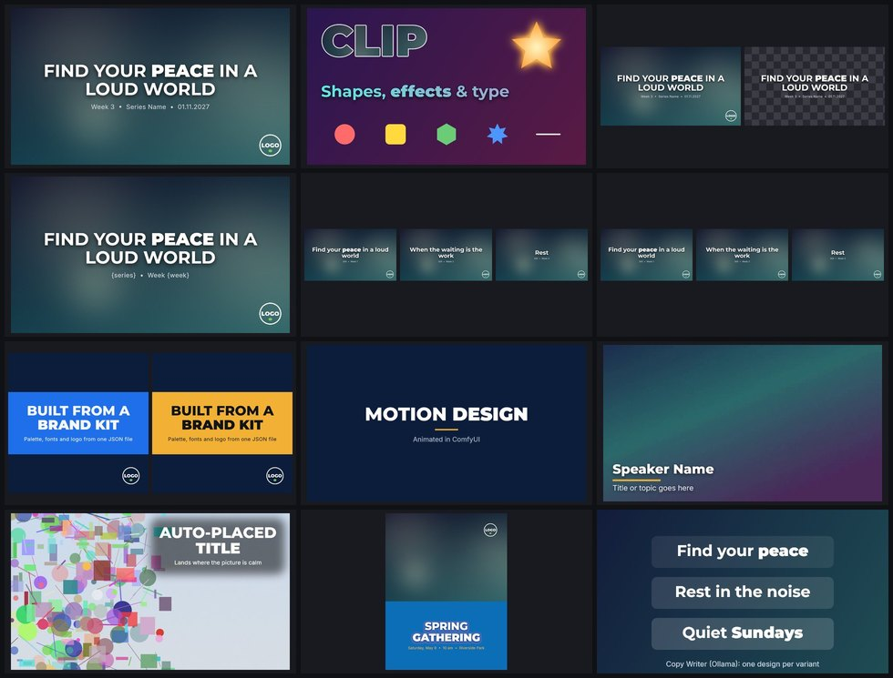

# CrateNode-Comfy

A design suite for ComfyUI: typography, layout, shapes, effects, templates,
data-driven batches, colour and brand kits, motion and video, smart layout helpers
and CMYK print output. 51 custom nodes that sit next to your image-generation
nodes, so one graph can generate a background, set the type, and export a
thumbnail, a video or a print-ready PDF.



**Version 1.0.0.** Every node is listed in [docs/nodes.md](docs/nodes.md); changes
are in [CHANGELOG.md](CHANGELOG.md).

## Install

1. Clone into ComfyUI's `custom_nodes` folder and install the requirements into
   **the Python that runs ComfyUI** (cloning alone does not install them):

   ```
   cd ComfyUI/custom_nodes
   git clone https://github.com/jevan2000/cratenode-comfy
   python -m pip install -r cratenode-comfy/requirements.txt
   ```

   Use ComfyUI's own Python for that `python`, see
   [Troubleshooting](#troubleshooting). ComfyUI-Manager installs the requirements
   for you when it installs the pack.

2. For video, install [ffmpeg](https://ffmpeg.org) on PATH (or set `CRATENODE_FFMPEG`).
3. Restart ComfyUI. The nodes are under **CrateNode-Comfy** in the node menu.

Tested with ComfyUI 0.34.0 and 0.42.5 on Windows (Python 3.11), and the unit
tests run on Linux.

## Quick start

Open **Templates** in ComfyUI (Workflow → Browse Templates) and pick
**cratenode-comfy**: the sixteen example workflows below open ready to run, and
together use every node. Their
Load Image / Load Video nodes use the placeholder files in `api_examples/assets/`;
copy those into ComfyUI's `input` folder (the install script does) or pick your own.

## How it works

Designs flow between nodes as a **scene** (`CN_SCENE`): a canvas plus text, shapes,
images and groups that stay vector until you render. That means sharp output at
any size, layouts that reflow when text changes, and PDF export. **Render Scene**
turns a scene into an `IMAGE` + alpha `MASK` for any other ComfyUI node; **Add
Image** brings any `IMAGE` (an AI background, a logo) into a scene.

Item nodes (Text Box, Shape, Add Image) take an optional `scene`: connected, they
add to it; left empty, they make a *part* for Stack, Place or Grid, which position
parts by their size so you never compute coordinates.

While you build, drop a **Preview Scene** anywhere in the chain to see the design
so far; the scene passes straight through, so it can stay in place. Turn on
`guides` to see the safe area and where each item sits.

**Live previews:** Canvas, Text Box, Shape, the gradients, Palette, Safe Area,
Contrast Check and the effect nodes (Drop Shadow, Outer Glow, Outline, Blur,
Opacity & Blend, Clip to Previous) show a picture at the bottom of the node that
follows their settings as you change them, before anything runs. The pack's own
code draws it (through a small endpoint, `/cratenode/preview`), so it looks exactly
like the output. Effect nodes show their effect on a sample "Aa". Values arriving
through a link aren't known until the workflow runs, so the preview uses the
widget's own value.

**Stroke editor:** click Shape's `stroke_style` field (it shows a small sample of the
style) for a pop-out with:
- **presets:** solid, dashed, long and short dash, dotted, dash dot, double,
  thick + thin, thin + thick, outer ring, inside and outside border, sharp corners,
  and behind the fill;
- the stroke **width**;
- **alignment:** centre, inside (the stroke stays within the shape) or outside;
- **dashes**, with your own on,off pattern and an offset;
- **ends:** round, flat or square; **corners:** round, sharp or bevel;
- a **second line** with its own width and gap, inside or outside;
- **behind the fill**.

The node's live preview follows as you click. Escape undoes, Done keeps. The style is
saved as short text, e.g. `align=inside; dash=3,2; double=0.6,2,inside`, so it can
also be typed or sent through the API. Lengths are in stroke widths, so a style keeps
its look at any width. Empty means the plain centred stroke.

**Grid** fills `vertical` (each row left to right, growing down; the count is
columns) or `horizontal` (each column top to bottom, growing right; the count is
shown as rows). `placement` puts each part `within cell` (at align/valign inside its
cell) or `on grid line`: centred on the cell line that align/valign names (left/top
= the cell's first line, right/bottom = its last, center/middle = its centre), so
parts sit on the lines and their crossings. It shows its layout on a 1920 x 1080 stand-in canvas: numbered tiles of
different sizes (one per connected part, or six when none are connected yet), the
cells as grey dashed boxes and the area in cyan, so `columns`, gaps, `align`,
`valign` and the area choice can be seen as you change them.

**Colour picker:** every hex colour field (`color`, `stroke_color`, `background`,
`matte` and so on) shows a small chip with its colour (a checkerboard shows through
transparency; a red line means no colour, such as empty, `transparent` or `auto`).
Click the field to open a picker with three tabs: RGB sliders (the default), HSL
sliders, or Swatches (a honeycomb of ready colours plus a row of greys; click one).
The tab you used last is remembered. It also has opacity, a box to type a hex code (`#rrggbb`, `#rgb` or `#rrggbbaa`),
an eyedropper (Chrome and Edge) and your recent colours. The field and the live
preview follow as you drag or type; Escape puts the old value back, Enter, Done or
a click outside keeps the new one. Fields that accept special values get buttons for
them (Transparent, Auto, None). The field still holds plain text
(`#rrggbb`, or `#rrggbbaa` with opacity), so workflows and the API are unchanged.

## Nodes

Full inputs and outputs: [docs/nodes.md](docs/nodes.md).

| Group | Node | What it does |
|---|---|---|
| Canvas | **Canvas** | Size from a preset (YouTube, Instagram, Story, Letter @300dpi, ...) or custom; background colour, gradient or `transparent` (for overlays and logos); safe-area margin |
| | **Safe Area** | Set the safe-area margins in pixels |
| Fill | **Linear Gradient**, **Radial Gradient** | Up to 4 colour stops, for canvases, shapes and text |
| Type | **Text Box** | Fonts from your folders, wrapping, align, vertical anchor (bottom grows upward), auto-fit, `*bold*` words, case, letter spacing, gradient text |
| Shapes | **Shape** | Rectangle (rounded), ellipse, line, polygon, star; fill or gradient with its own opacity (0 + a stroke = outline only), stroke, rotation |
| Image | **Add Image** | Fit, fill (crop) or stretch an image into a box |
| | **Image to Scene** | Bring an image (an AI generation, a photo) into a design: a new canvas its size, or under / on top of / in place of an existing design, fitted to its canvas; a batch gives one design per image |
| Layout | **Stack** | Up to 6 parts in a column or row with a gap, placed in the safe area / canvas / a custom box |
| | **Place** | One part at an alignment (e.g. a logo bottom-right of the safe area) |
| | **Grid** | Up to 9 parts in equal cells |
| | **Layers** | Scenes on top of each other |
| Effects | **Drop Shadow**, **Outer Glow**, **Outline**, **Blur** | On the last item or the whole scene so far |
| | **Opacity & Blend** | Opacity and 17 blend modes (multiply, screen, overlay, ...) |
| | **Clip to Previous** | Show the last item only inside the one before it (a photo inside text) |
| Output | **Preview Scene** | See the design so far anywhere in a chain (the scene passes through): a quick preview on the node, transparency over a checkerboard, optional safe-area and item-outline guides, any moment of an animation |
| | **Scene to Image** | Convert a design for any other pipeline (img2img, ControlNet, inpainting, Save Image, upscalers): size by scale, fit or exact, rounded to a multiple of 8 / 64 for diffusion models; keep transparency (IMAGE + MASK) or flatten onto a colour |
| | **Render Scene** | IMAGE + alpha MASK at any scale |
| | **Export Image** | PNG, JPEG or WebP from a scene or any IMAGE batch: transparency kept (PNG/WebP) or flattened onto a matte, scale, DPI tag, sRGB profile, workflow embedded, and a `max_kb` budget that lowers quality until the file fits |
| | **Save PDF** | Vector PDF, fonts embedded |
| Data | **Load Template** | A saved design (JSON) as a scene, from your templates folder or the bundled ones |
| | **Fill Template** | Replace slot text, `name.color` colours, `{placeholders}` and image slots from a data row or a values box; layouts reflow |
| | **Save as Template** | Write a design to a template JSON (images embedded) |
| | **Data Rows** | Rows from a CSV/JSON file or pasted text; everything after it runs once per row |
| | **Row Value** | One column of a row as text, for any text input |
| Colour | **Palette** | Named colours (`primary: #1f6feb` lines) with a swatch preview |
| | **Palette from Image** | An image's main colours and their shares (k-means in Lab, similar colours merged) |
| | **Brand Kit** | A brand JSON: palette, heading/body fonts and weights, logo |
| | **Pick Color** | One colour as `#hex` for any colour input: by name, the most readable against a background, lightest, darkest |
| | **Contrast Check** | WCAG contrast ratio and grade (AA / AAA) |
| | **Recolor Scene** | Swap colours throughout a design (`primary -> accent`) |
| Motion | **Timeline** | A design's length and frame rate |
| | **Animate In**, **Animate Out** | Presets: fade, fade up/down, slides, pop, zoom, wipe, blur in; stagger plays the parts of a Stack / Grid in turn |
| | **Animate** | Keyframes (`0: 0, 2: 360`) with easing for x, y, scale, rotation, opacity, blur or wipe |
| | **Add Video**, **Video to Scene** | Video frames (an IMAGE batch) inside a design, or a design on top of a video |
| | **Render Frame** | One moment as IMAGE + alpha |
| | **Render Animation** | All frames as an IMAGE + MASK batch (for VideoHelperSuite or any image node) |
| | **Save Video** | MP4 (H.264), MOV (ProRes 4444 with alpha), WebM (VP9 with alpha) or GIF, with audio; streamed through ffmpeg |
| Smart | **Auto Place** | Put a part where the design (or a given image) is calmest, inside the safe area; optionally switch its text to white or near-black |
| | **Find Quiet Area** | The calmest box of a size in any image: x, y, size, a readable text colour and a heat map |
| | **Readability Check** | WCAG contrast of each text against the pixels behind its letters; report and a pass/fail overlay |
| | **Smart Scrim** | A gradient band, box or soft glow under the last item, only as strong as needed to reach a contrast |
| | **Copy Writer (Ollama)** | Headlines, shorter text, subtitles, taglines or calls to action from a local Ollama model; variants come out as a list (one design each) |
| Print | **Save Print PDF (CMYK)** | CMYK PDF: vector (text stays text, exact CMYK for flat colours) or flattened; bleed, crop marks, trim/bleed boxes, the profile as output intent |
| | **Soft Proof (CMYK)** | How a design will print through the profile, and a mask of out-of-gamut colours |
| | **CMYK Values** | The CMYK a colour prints with (profile or your exact value) |

Masks: our `MASK` outputs are coverage (1 = opaque). ComfyUI's **Load Image** mask
is the opposite (1 = transparent), so image inputs have a `mask_meaning` switch.

## Templates and data batches

Give an item a **slot** name (Text Box, Shape and Add Image have a `slot` input)
or type `{placeholders}` in any text, then **Save as Template**. **Fill Template**
changes a template by name:

```
title: When the waiting is the work      <- a text slot
title.color: #ffcc00                     <- a text or shape slot's colour
series: Still                            <- fills {series} in any text
```

Image slots take an IMAGE (`image_1` + `slot_1`). Stack, Place and Grid lay
out when the design is drawn, so a longer title still pushes the rest down.

**Data Rows** reads a CSV (header line) or JSON list and outputs one row at a
time: ComfyUI runs the nodes after it once per row. Wire the row into Fill
Template (or Row Value → any text input) and into Export Image / Save PDF,
whose `filename_prefix` takes `{column}` names plus `{date}`, `{time}` and
`{index}`, e.g. `batch/{index}_{title}`.

Templates are read from `templates/` in your data folder (`data_dir` in the
config) and from this package's `templates/`.

## Colour and brand kits

A brand kit is a folder with a `brand.json` (see `brand/example/`):

```json
{"cratenode_brand": 1, "name": "Example Co.",
 "colors": {"primary": "#1f6feb", "accent": "#f2b134"},
 "fonts": {"heading": {"family": "Montserrat", "weight": 800}, "body": {"family": "Inter", "weight": 400}},
 "logos": {"primary": "logo.png"}}
```

Kits are read from `brand/` in your data folder and from this package's
`brand/`. Wire **Brand Kit**'s fonts into a Text Box's `font_override` and
`weight`, its logo into Add Image (with `mask_meaning` set to alpha), and
**Pick Color** outputs into any colour input. With a palette connected, Fill
Template and Recolor Scene accept colour names (`title.color: accent`).

## Motion and video

Animation is added to items like effects: **Animate In** after a Text Box
animates that box; after a Stack (with `stagger`) it animates the parts one
after another. Animation only moves, scales, fades, blurs or wipes what the
layout already placed, so layouts never jump. **Timeline** sets the length (or
leave it at 0: the last animation + 1 s).

**Save Video** renders frame by frame straight into ffmpeg, so long or 4K videos
don't fill memory. It needs `ffmpeg` on PATH (or `CRATENODE_FFMPEG` pointing at
it). For overlays, load a clip with ComfyUI's **Load Video** → **Get Video
Components**, start the design with **Video to Scene**, and pass the audio to
Save Video.

Speed tip: an item with effects (shadow, glow, outline) is drawn once and then
moved per frame, unless something inside it is animated. For a shadowed title
that animates in parts, put the shadow on each part, not on the Stack.

## Smart helpers

The helpers use image statistics, not models: busyness is edges plus local
contrast; readability is the WCAG contrast of each text against the pixels behind
its letters (the worst 10 %). They run on the CPU. Nodes with a `device` input can
run on the GPU instead (`gpu when free`): set `gpu_gate` in the config (or the
`CRATENODE_GPU_GATE` environment variable) to a URL answering `{"ok": true|false}`
and the GPU is used only when it says yes, otherwise the CPU (the report says why).

**Copy Writer** talks to a local [Ollama](https://ollama.com) server with the
model you name; nothing is downloaded for you. Its `variants` output is a list, so
a Text Box fed by it makes one design per variant.

## Print (CMYK)

**Save Print PDF** writes the design with skia's PDF backend (text stays text,
fonts embedded, shadows and glows as their own layers at print resolution) and
converts it to CMYK: colours of text, shapes and gradients become `k`/`K` values,
images go through the ICC profile, and the profile is embedded as the output
intent. `flatten` makes it one CMYK image instead (blend modes then look as on
screen).

- **Profile:** set `cmyk_profile` in the config to your printer's ICC profile
  (none ships with this package), or pick one found in the data folder's `color/`
  or the system colour folder. Without one, colours are uncalibrated and the
  report says so.
- **Exact values** for vector colours: `primary = 90 55 0 0` or `#1f6feb = 90 55 0 0`
  (percent). `pure_black` prints `#000000` as 0/0/0/100.
- **Bleed:** start from a Canvas preset with bleed (e.g. US Letter + 1/8in bleed,
  2625x3375 @300dpi) and keep `canvas includes bleed`; the TrimBox is set inside it.
  `extend background` grows the page by the bleed in the background colour.

## Examples

Each example exists twice: in `example_workflows/` (UI format, with a thumbnail;
ComfyUI lists them under Templates) and in `api_examples/` (API format, for
scripts). Run one headless:

```
python tools/run_workflow.py api_examples/thumbnail.api.json --server http://127.0.0.1:8188
```

- **thumbnail**: background image, headline with shadow and subtitle in a Stack, logo placed bottom-right.
- **export**: the thumbnail saved four ways: a YouTube JPEG under 2 MB, a half-size WebP for the web, the title alone as a transparent PNG overlay, and a 2x JPEG tagged 300 dpi made from a rendered IMAGE.
- **template_save**: the thumbnail with slots (`background`, `title`, `subtitle`, `logo`) saved as a template; it is bundled as `templates/thumbnail.json`.
- **batch_template**: three CSV rows → Load Template → Fill Template → one JPEG per row, named from the row.
- **batch_workflow**: the same batch with the graph as the template (Row Value feeds the Text Box).
- **colour**: a square card built from the example brand kit (colours, fonts, logo; title colour picked for contrast), a recoloured variant (`primary -> accent`), a contrast check, and a palette taken from the background photo.
- **motion**: an animated title card (staggered rise-and-blur, logo pop, fade out) saved as MP4 and GIF, plus a transparent WebM overlay version.
- **video_overlay**: a lower third sliding in over a clip (core Load Video), saved as MP4 with the clip's audio.
- **smart**: a title auto-placed in the calm side of a busy picture, readability checked before and after a smart scrim, and Find Quiet Area's heat map.
- **copy_variants**: three headline variants from Copy Writer, one design each (set `model` to an installed Ollama model first).
- **print**: a US Letter flyer with bleed from the example brand kit, saved as a vector CMYK PDF and a flattened one with crop marks, plus a soft proof, an out-of-gamut mask and CMYK values.
- **layers_blend**: a typed-in palette, wider safe-area margins, circles in multiply, a blurred star, and a type layer put on top with Layers.
- **keyframes**: keyframe animation (a video sliding in picture-in-picture, a spinning and pulsing star, a wiped-in title), rendered as a frame batch and saved as MP4 from that batch.
- **scene_to_image**: the thumbnail converted for other pipelines: flattened, 1024 wide and rounded to 64 (SDXL-ready) into Save Image, and the type alone with its transparency as IMAGE + MASK.
- **image_round_trip**: a batch of (stand-in) generations each put under the same type design (one export per image), and a round trip: the design out through Scene to Image to a pipeline (a blur stands in for img2img / ControlNet / an upscaler) and back under the original, still-sharp type with Image to Scene.
- **showcase**: gradient canvas, a photo clipped inside outlined text, a glowing star, gradient text, a grid of shapes, a 2x render.

## Configuration

Fonts, private templates, brand kits and colour profiles are read from places you
configure, so licensed material never has to live inside this package. Put a
`config.local.json` in the package folder (it is git-ignored), or point
`CRATENODE_COMFY_CONFIG` at a JSON file:

```json
{
  "font_folders": ["D:/fonts"],
  "font_catalogs": ["D:/fonts/catalog.json"],
  "system_fonts": true,
  "data_dir": "D:/design-data",
  "cmyk_profile": "D:/design-data/color/printer.icc",
  "licence_scope": "Client Name",
  "gpu_gate": ""
}
```

| Key | What it does |
|---|---|
| `font_folders` | Fonts to offer first (then the bundled OFL fonts, then system fonts) |
| `font_catalogs` | Licence data: `free`, `scoped` (licensed for named clients), `restricted`, `unknown`. Text Box and every save node warn (never fail) when a font is used outside its licence |
| `licence_scope` | Who the designs are for; checked against scoped licences |
| `data_dir` | Your `templates/`, `brand/` and `color/` folders, and relative data-row files |
| `cmyk_profile` | ICC output profile for print PDFs |
| `gpu_gate` | URL answering `{"ok": true}` or `{"ok": false}` before GPU work (see Smart helpers) |
| `data_roots` | Extra folders that Data Rows, Load Template and Brand Kit may read files from (always allowed: `data_dir`, ComfyUI's `input` folder, this package) |
| `allowed_hosts` | Extra hosts Copy Writer may call (always allowed: this machine) |

Workflows can be shared, so the pack only reads files from those folders and only
sends text to this machine unless you allow more. See [SECURITY.md](SECURITY.md).

## Troubleshooting

**"IMPORT FAILED" for cratenode-comfy, or `No module named 'skia'` in the log.**
The pack's Python packages (skia-python, pypdf) aren't installed in the Python that
runs ComfyUI. Cloning a node pack doesn't install them, and `pip` on its own often
points at a different Python. The log names what's missing and the exact command;
it is one of these, run from the `ComfyUI` folder:

| ComfyUI install | Command |
|---|---|
| Portable (Windows) | `..\python_embeded\python.exe -m pip install -r custom_nodes\cratenode-comfy\requirements.txt` |
| A `venv` / `.venv` inside ComfyUI | `.venv\Scripts\python.exe -m pip install -r custom_nodes\cratenode-comfy\requirements.txt` (on Linux/macOS `.venv/bin/python`) |
| Desktop app | Open its terminal (bottom panel) and run `python -m pip install -r custom_nodes/cratenode-comfy/requirements.txt` |
| Unsure | The ComfyUI log prints `** Python executable:` at startup; use that one |

Then restart ComfyUI. Installing through ComfyUI-Manager does this for you.

**Text nodes fail with "SkIcuLoader datafile missing" (Windows).** skia's text
layout looks for `icudtl.dat` next to the *base* `python.exe` (for a venv: the Python
it was made from). Copy it from `site-packages` (where skia-python put it) to that
folder; `tools/install_sandbox.ps1` does this.

**`libEGL.so.1` (or `libGL`, `libfontconfig`) missing (Linux).** skia-python needs
a few system libraries: `sudo apt-get install libegl1 libgl1 libfontconfig1`.

**Only Inter and Montserrat in the font list.** Those are the bundled fonts. Point
`font_folders` in a `config.local.json` at your fonts (see Configuration), or keep
`system_fonts` on and type an installed family into the Text Box's `font_override`.

**Save Video says ffmpeg was not found.** Install ffmpeg on PATH (ComfyUI must be
started after that), or set `CRATENODE_FFMPEG` to the full path of `ffmpeg.exe`.

**The nodes don't appear in the menu or search after installing.** If the log
shows the pack loaded (`CrateNode-Comfy 1.x: ... font faces`), reload the browser
tab (Ctrl+Shift+R): a tab opened before ComfyUI restarted keeps the old node list.

**No live previews or colour chips on the nodes.** Reload the ComfyUI page after installing or
updating the pack (the browser caches the old scripts). They appear on Canvas, Text
Box, Shape, gradients, Palette, Safe Area, Contrast Check and the effect nodes.

**A render comes out black.** Check that the chain starts from a **Canvas**: a part
on its own has a transparent background, and Save Image drops transparency.

## Development

```
python -m pip install -r requirements.txt -r requirements-dev.txt
python -m unittest discover -s tests -v
```

Tools: `run_workflow.py` (run an API workflow headless), `api_to_ui.py` (API →
UI workflows), `make_thumbnails.py`, `gen_node_docs.py` (docs/nodes.md from a
running ComfyUI), `make_placeholders.py` (the example assets),
`install_sandbox.ps1` (`-Workflows` also copies the examples into ComfyUI's
Workflows sidebar, folder CrateNode-Comfy).

## Licence

MIT. See [LICENSE](LICENSE). Bundled example fonts are under the SIL Open Font
License (see `fonts/`).
